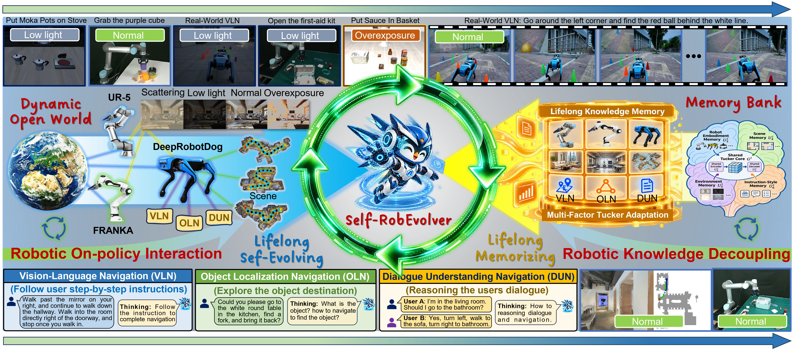
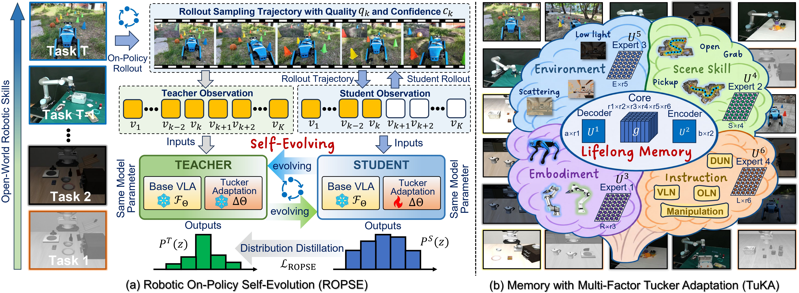
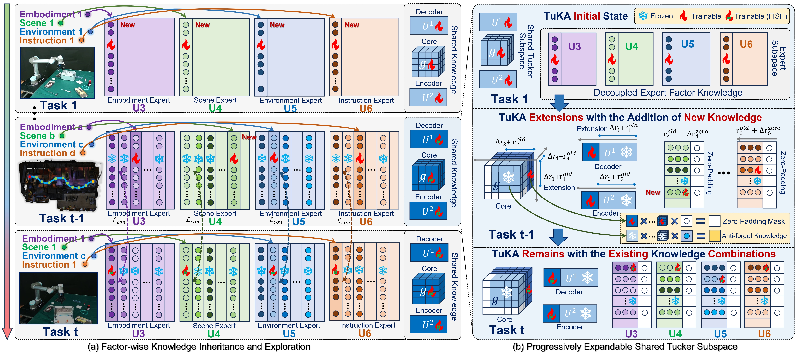
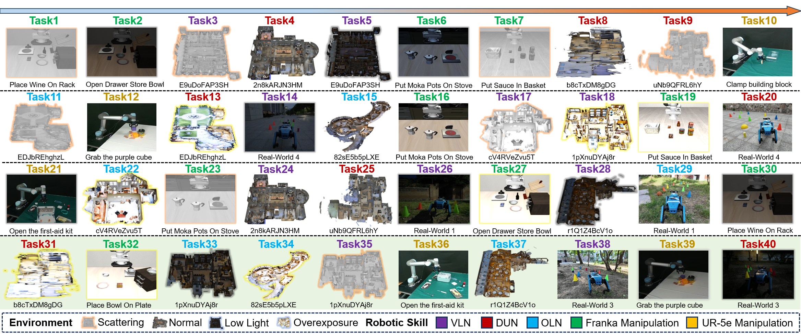

# Lifelong Self-Evolving Robot Learning via Multi-Factor Tucker Adaptation

## Overview

**Lifelong Self-Evolving Robot Learning (LSERL)** studies robotic agents that continually acquire skills from their own interaction experience while preserving and reusing previously learned knowledge. Tasks couple four factors: **robot embodiment, physical scene, environmental condition, and instruction style**.

**Self-RobEvolver** combines **Robotic On-Policy Self-Evolution (ROPSE)** with **Multi-Factor Tucker Adaptation (TuKA)**. ROPSE transfers privileged knowledge from realized future observations to a current-observation student. TuKA organizes acquired knowledge into reusable factor memories, forming a co-evolving loop between autonomous skill acquisition and lifelong memory.

This repository provides the core method implementation and configuration templates. UniVLA checkpoints, embodiment-specific action heads, datasets and environment execution are connected through the RobotBridge interface. The six-mode LSERL implementation is in self_robevolver; streamvln retains legacy navigation-only components.

## Method

- **ROPSE.** Sample and execute student-policy actions, evaluate subsequent progress and teacher confidence, and distill the resulting future-informed distribution into the student with a reliability-weighted forward KL. Teacher targets and reliability weights are detached, including weights in both the numerator and denominator of the normalized objective.
- **Six-mode TuKA.** Represent adaptations along output, input, embodiment, scene, environment and instruction-style modes. Compose a task-specific matrix from four factor memories and a shared Tucker core.
- **Factor-wise Knowledge Inheritance and Exploration (FKIE).** Allocate new factor rows with orthogonality regularization, reuse existing rows with consistency regularization, and freeze unrelated memories.
- **Progressively Expandable Shared Tucker Subspace (PESTS).** Expand capacity when new factor categories appear, preserve historical coordinates through fixed-zero constraints, and use Fisher-guided refinement for combinations of previously learned factors.
- **Task-specific factor search.** Identify embodiment from hardware and independently retrieve scene, environment and instruction style through visual/text prototypes.

For selected factor vectors, the adaptation is

$$
C = G \times_3 u_{\mathrm{robot}} \times_4 u_{\mathrm{scene}}
      \times_5 u_{\mathrm{env}} \times_6 u_{\mathrm{style}},
\qquad
\Delta W = U_{\mathrm{out}} C U_{\mathrm{in}}^\top.
$$

The pretrained backbone remains frozen. Expansion preserves historical adaptations immediately before subsequent optimization; consistency and Fisher regularization control later refinement. At inference, the student uses only available observations and instructions.

## LSERL benchmark

| Factor | Coverage |
| --- | --- |
| Embodiment | Navigation agents, Franka Panda and UR5e |
| Scene | Simulated navigation/manipulation scenes and real-world workspaces |
| Environment | Normal, low light, overexposure and scattering |
| Instruction style | VLN, OLN, DUN and manipulation instructions |

The LSERL benchmark contains 40 tasks: tasks 1--30 are learned sequentially, while tasks 31--40 are held-out combinations of learned factor categories used only for evaluation. Held-out tasks do not update the policy, Fisher memory or retrieval prototypes.

## Installation

Create a Python 3.10 environment and install the core dependencies:

~~~bash
conda create -n self-robevolver python=3.10 -y
conda activate self-robevolver
pip install -r requirements.txt
~~~

Run commands from the repository root. A real UniVLA/Habitat/LIBERO deployment also needs its backbone and environment dependencies, model weights, data and action heads.

## Training

~~~bash
bash scripts/train.sh \
  --config config/robot.yaml \
  --tasks config/task.yaml \
  --bridge your_integration:build_bridge \
  --output outputs/self_robevolver
~~~

Tasks 1--30 collect fresh on-policy rollouts, optimize ROPSE with factor-memory regularization, then consolidate final-policy Fisher and retrieval prototypes. Adaptation checkpoints are written as task_001.pt through task_030.pt.

## Evaluation

~~~bash
bash scripts/evaluate.sh \
  --checkpoint outputs/self_robevolver/task_030.pt \
  --tasks config/task.yaml \
  --bridge your_integration:build_bridge \
  --max-steps "$MAX_EPISODE_STEPS"
~~~

Inference restores factor memories and retrieves their combination from the initial observation, instruction and hardware identity. It neither accesses future observations nor updates the learned memories.

## License

See [LICENSE](LICENSE). Upstream components and model/data assets retain their respective licenses.

The cleaned source code will be released entirely when the manuscript is accepted
